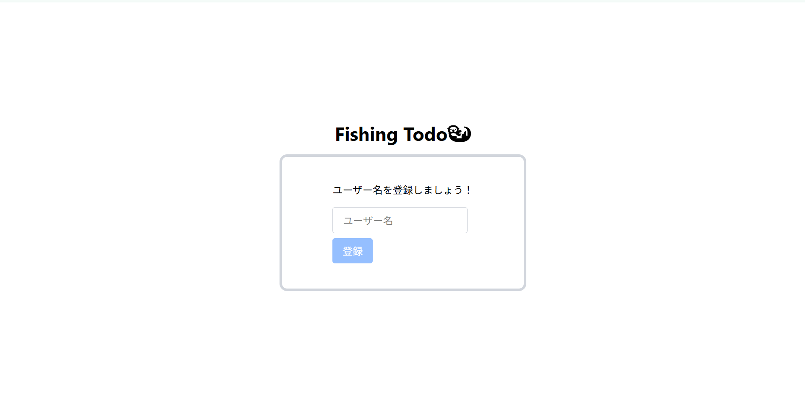
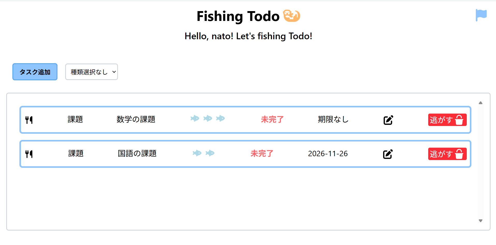
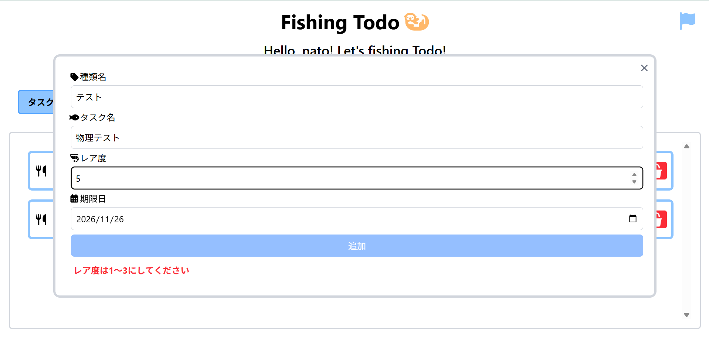
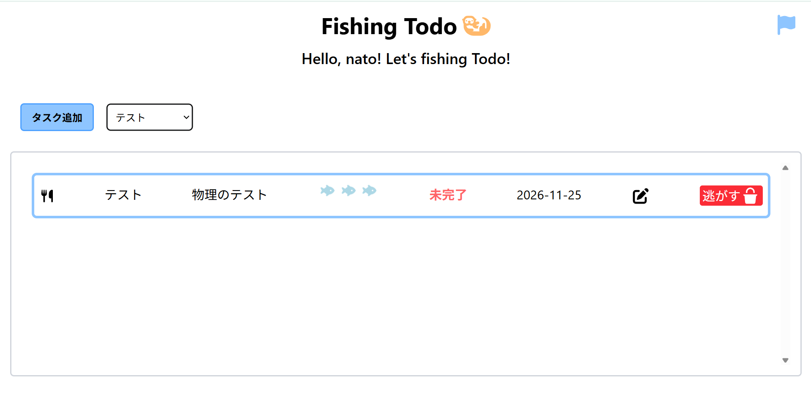
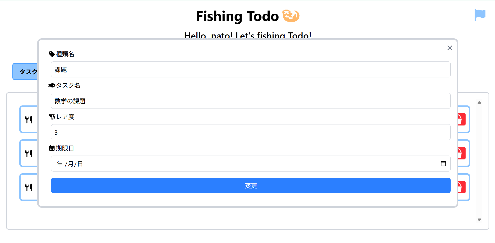
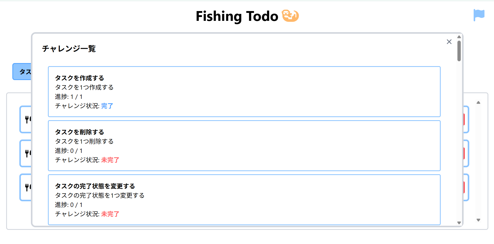

# FishingTodo

React、TypeScript、Tailwind CSS を使用し、ローカルストレージでデータを永続化したTodoアプリです。  
**[Todoアプリへ](https://nato-git.github.io/FishingTodo/user)**

## 機能

初めにユーザー名を登録することができ、自分だけのTodoアプリを感じながら使用することができます。ユーザー名はオレンジ色のラッコからいつでも変えることができます。  
また、チャレンジ欄がついており、ゲーム感覚でタスクを追加したり達成したりすることができます。  
魚をメインにしているアプリとなっており、視覚的に楽しいものとなっています。  
タスクの作成には、種類名(タグ)をつけることができ、タスクをジャンルで分けることができます。 
レスポンシブ対応しており、スマートフォンで使用しても崩れにくくなっています。 

## 開発背景

Todoアプリは基本楽しくないものであり、長続きしにくい経験があるため、楽しく使えるTodoアプリを目指しました。  

## 開発技術

技術は主にTypeScript、Reactを使用し、デザインはTailwind CSSを使用しました。  
Todoデータの保存は、ローカルストレージを使用しています。

## 使用画面

  
---
  
---

---

---

---

## 開発期間

2026年10月30日 ～ 2026年11月3日 (取り組み時間：約28時間)

## ライセンス

**[MITライセンス](LICENSE)** はここから見ることができます。